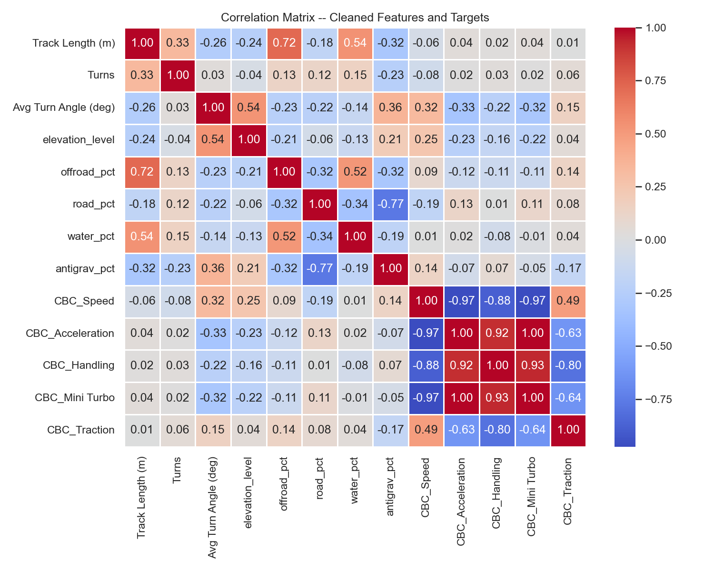
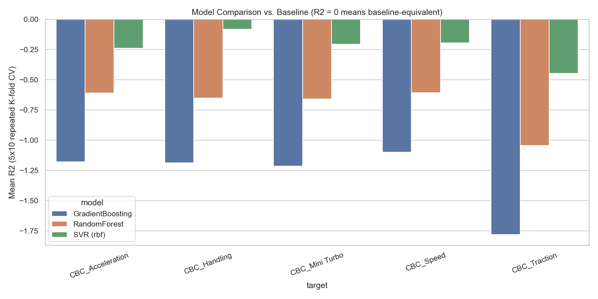
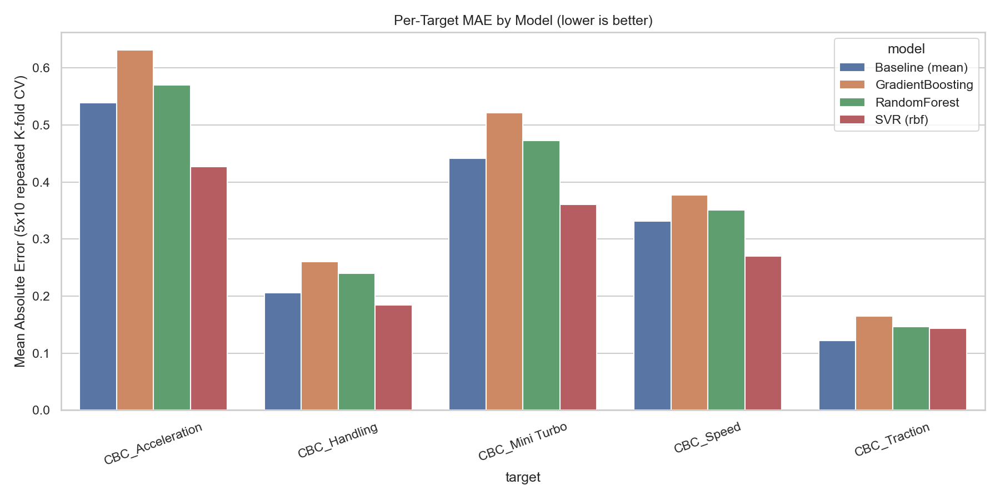
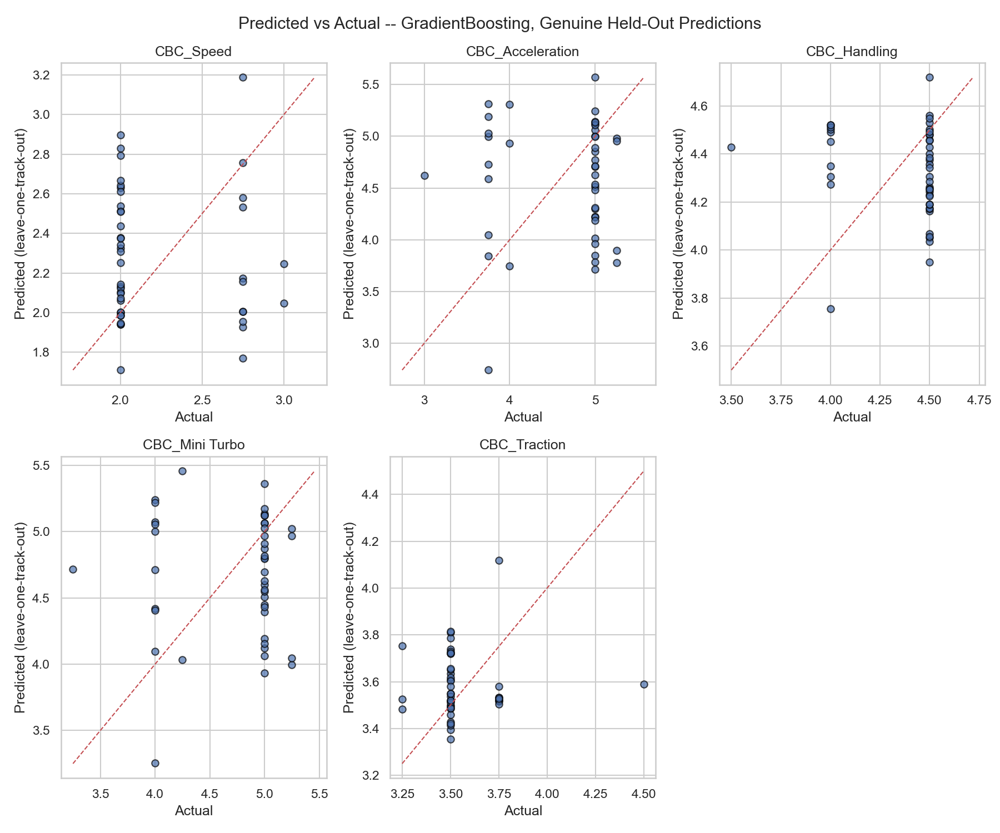

# Predicting the Best Mario Kart 8 Build for a Given Track

A solo MSc data science mini-project: given a Mario Kart 8 track's measurable
properties, can we predict the attributes of its community-agreed best build
(driver + kart + tires + glider, 700,000+ possible combinations)?

**Headline results:**
- After removing target leakage and recomputing build stats from a verified source, **no model (RandomForest, SVR, GradientBoosting) beats a naive mean-prediction baseline** on 5x10 repeated K-fold CV, or on a genuine leave-one-track-out test (R2 is negative for every model/target pair). This is the honest result for 45 usable tracks, not a tuning failure.
- Before cleaning, the same pipeline reported R2 up to **0.99** — entirely target leakage (other targets and leaky terrain-split columns were present as input features). Fixing that is the main technical contribution here.
- After fixing duplicate/inconsistent build stats, only **6 distinct target vectors** exist across the 45 modelled tracks — the "best" build is a small set of community-favourite picks (heavily Yoshi-biased), not a per-track optimum, which is largely *why* the models can't beat the baseline.

## 1. Problem and why it's interesting

Mario Kart 8 has over 700,000 possible driver/kart/tire/glider combinations.
Community sites publish a single "best" build per track, but it's not
obvious how a track's physical properties (length, turns, terrain,
elevation) should drive that choice, or whether they do at all. This project
treats it as a supervised learning problem and, in the process, surfaces a
more interesting finding than the original goal: the "ground truth" target
itself is biased toward a handful of popular community picks, which caps
what any model can learn from it.

## 2. How the question was refined

- **Q1 — "best combo given attribute priorities"**: fails. Players don't
  understand how the five build attributes (speed, acceleration, handling,
  mini-turbo, traction) trade off, so asking them to rank priorities
  directly doesn't produce a usable interface.
- **Q2 — "best combo given attribute values"**: this is a lookup against
  existing combo data, not prediction. No modelling problem here.
- **Q3 — "best combo given a specific track"**: tracks are fixed and
  measurable, so this is a genuine supervised learning problem — predict a
  track's best-known build attributes from the track's own features. This
  is what's modelled.

## 3. Dataset

52 Mario Kart 8 tracks, compiled by hand. Columns (post-cleaning):

| Column | Description |
|---|---|
| `Track Name` | Track identifier |
| `Track Length (m)` | Track length |
| `Turns` | Number of turns |
| `Lap Count` | Laps per race |
| `Avg Turn Angle (deg)` | Average turn sharpness |
| `elevation_level` | 0=Low, 1=Moderate, 2=High elevation change |
| `offroad_pct` / `road_pct` / `water_pct` / `antigrav_pct` | Terrain composition, % |
| `Community Best Combo` | The community's chosen build for this track |
| `CBC_Speed` / `CBC_Acceleration` / `CBC_Handling` / `CBC_Mini Turbo` / `CBC_Traction` | **Targets** — the chosen build's 5 attributes |
| `flag_target_unverified` | 1 if the build uses a Deluxe-only part not covered by the stat chart (see below) — excluded from modelling |
| `flag_terrain_pct_invalid` | 1 if the terrain-share columns don't sum to 100% in the raw data |

**Sources & credit**: track geometry measured from gameplay by hand. Build
stats are recomputed from **Luigi_Fan2's Mario Kart 8 stat chart** (a
community reference for the original Wii U release), not redistributed in
this repo — see `DATA_NOTICE.md`. Game names, characters, and stats belong
to Nintendo.

### The two-batch inconsistency, and how it was fixed

The raw 52-row CSV (`data/mk8_tracks.csv`) was collected in two batches with
incompatible encodings: rows 1–31 use numeric terrain/elevation codes and an
integer 3–5 build-stat scale, rows 32–52 use text labels and a decimal
1.75–4.5 scale. Every fix below is implemented and commented in
`src/clean.py`, which produces `data/mk8_tracks_clean.csv`:

1. **Build stats (`CBC_*`) were recomputed from the stat chart, not
   rescaled.** Each row names an exact build, and MK8 build stats are
   deterministic (`character base + body delta + tire delta + glider
   delta`), so the right fix is to recompute, not guess a scale conversion.
   45/52 rows (87%) recompute cleanly. 7 rows use Deluxe-exclusive parts
   (Birdo, Funky Kong, Kamek ×3, Peachette, Inkstriker) absent from the
   Wii U-era chart — these are flagged (`flag_target_unverified=1`), keep
   their original raw values, and are **excluded from model training**
   (kept in the CSV for transparency). Of the 45 recomputed rows, **all 45
   changed** vs. their raw hand-entered values — e.g. "Pink Yoshi +
   Biddybuggy + Azure Roller + Paper Glider" previously had different
   stats on different tracks despite being the same build everywhere; it's
   now consistent. Full diff in `data/mk8_cbc_recompute_diff.csv`.
2. **Terrain Type (numeric codes vs. text) was dropped, not mapped.** The
   two batches cover disjoint tracks, so there's no row to verify a
   code→label mapping against, and the text batch never uses "Water" or
   "Off-Road" as a label at all — codes 2 and 3 are unverifiable. The
   `*_pct` terrain-share columns already carry the same information
   continuously, so this categorical column was dropped rather than
   guessed.
3. **Elevation Changes (0/5/10 vs. Low/Moderate/High) was mapped, because
   it's ordinal.** With exactly 3 levels on each side, `0→Low, 5→Moderate,
   10→High` is the only order-preserving mapping — not a guess about
   meaning, just the one consistent ordering. Encoded as `elevation_level`.
4. **Terrain share columns (plain numbers vs. "NN%" strings) needed parsing,
   not rescaling.** Both represent the same 0–100% scale (rows sum to ~100
   in 50/52 cases). The 2 exceptions (`N64 Rainbow Road` sums to 105,
   `Big Blue` sums to 200 — listed as both 100% Water *and* 100%
   Anti-Grav, clearly a data error since the real track is 100%
   anti-gravity) are flagged, not silently corrected.
5. **Average Speed (m/s) was dropped, not rescaled.** Batch A mean ≈17.8
   m/s vs. batch B mean ≈9.4 m/s looked like a possible 2× unit bug, but
   checking implied race duration (`length × laps / speed`) shows the two
   batches are already roughly comparable once track length is accounted
   for — the difference is mostly explained by batch B's genuinely shorter
   tracks, not a fixed conversion factor. With no single verifiable
   factor, the column is dropped. (Confirmed in the notebook's appendix:
   adding it back unreconciled doesn't change the result.)
6. **20 leaky `CBC_*_OffRoad/_Road/_Water/_AntiGrav` columns were dropped.**
   They are derived from the target `CBC_*` columns themselves
   (correlation 0.82–0.997 with their parent target) and must not be used
   as predictors.

## 4. Method

**Features** (8): track length, turns, average turn angle, elevation level,
and 4 terrain-composition percentages.

**Targets** (5): CBC_Speed, CBC_Acceleration, CBC_Handling, CBC_Mini Turbo,
CBC_Traction — multi-output regression.

**Models**: RandomForest, SVR (RBF kernel, per-target), GradientBoosting, all
wrapped in `MultiOutputRegressor` where needed, compared against a
`DummyRegressor(strategy="mean")` baseline. `random_state=42` throughout.

**Validation**: with 45 usable rows, a single train/test split (the original
approach) is highly sensitive to which rows land in the test set. This
project uses **5-fold CV repeated 10 times** (50 fold-estimates per
model/target), reporting mean ± std of R² and MAE, plus a **pooled
leave-one-track-out** pass for a genuine single-track holdout demo (replacing
the original notebook's "predict a new track" cell, which retrained on data
that likely included the demo track).

## 5. Results

### Before vs. after cleaning (5×10 repeated K-fold CV, R²)

| Target | Model | R² before cleaning | R² after cleaning |
|---|---|---:|---:|
| CBC_Speed | GradientBoosting | 0.981 | -1.098 |
| CBC_Speed | RandomForest | 0.986 | -0.607 |
| CBC_Speed | SVR | 0.665 | -0.196 |
| CBC_Acceleration | GradientBoosting | 0.975 | -1.178 |
| CBC_Acceleration | RandomForest | 0.973 | -0.610 |
| CBC_Acceleration | SVR | 0.291 | -0.239 |
| CBC_Handling | GradientBoosting | 0.968 | -1.185 |
| CBC_Handling | RandomForest | 0.973 | -0.650 |
| CBC_Handling | SVR | 0.277 | -0.085 |
| CBC_Mini Turbo | GradientBoosting | 0.857 | -1.213 |
| CBC_Mini Turbo | RandomForest | 0.884 | -0.659 |
| CBC_Mini Turbo | SVR | -0.003 | -0.207 |
| CBC_Traction | GradientBoosting | 0.971 | -1.779 |
| CBC_Traction | RandomForest | 0.957 | -1.044 |
| CBC_Traction | SVR | -0.161 | -0.449 |
| *(all targets)* | Baseline (mean) | ≈ -0.12 | ≈ -0.21 |

**"Before" R² up to 0.99 is target leakage**, not model skill: the raw
feature set still contained the 20 leaky terrain-split columns *and* the
other 4 target columns as predictors for each target. **"After" is the
honest number** — every model underperforms the baseline once leakage is
removed. See `notebooks/mariokart8_build_prediction.ipynb` §7 for the full
side-by-side table and methodology.

### After cleaning: full per-target table (5×10 repeated K-fold CV)

| Target | Model | MAE (mean ± std) | R² (mean ± std) |
|---|---|---|---|
| CBC_Speed | Baseline (mean) | 0.332 ± 0.041 | -0.212 ± 0.251 |
| CBC_Speed | SVR | 0.270 ± 0.083 | -0.196 ± 0.242 |
| CBC_Speed | RandomForest | 0.351 ± 0.063 | -0.607 ± 0.651 |
| CBC_Speed | GradientBoosting | 0.377 ± 0.085 | -1.098 ± 1.027 |
| CBC_Acceleration | Baseline (mean) | 0.539 ± 0.071 | -0.213 ± 0.247 |
| CBC_Acceleration | SVR | 0.427 ± 0.146 | -0.239 ± 0.277 |
| CBC_Acceleration | RandomForest | 0.570 ± 0.110 | -0.610 ± 0.612 |
| CBC_Acceleration | GradientBoosting | 0.631 ± 0.130 | -1.178 ± 0.907 |
| CBC_Handling | Baseline (mean) | 0.206 ± 0.034 | -0.147 ± 0.166 |
| CBC_Handling | SVR | 0.185 ± 0.049 | -0.085 ± 0.099 |
| CBC_Handling | RandomForest | 0.240 ± 0.039 | -0.650 ± 0.635 |
| CBC_Handling | GradientBoosting | 0.261 ± 0.051 | -1.185 ± 0.927 |
| CBC_Mini Turbo | Baseline (mean) | 0.442 ± 0.061 | -0.222 ± 0.276 |
| CBC_Mini Turbo | SVR | 0.360 ± 0.115 | -0.207 ± 0.254 |
| CBC_Mini Turbo | RandomForest | 0.473 ± 0.091 | -0.659 ± 0.641 |
| CBC_Mini Turbo | GradientBoosting | 0.521 ± 0.101 | -1.213 ± 0.932 |
| CBC_Traction | Baseline (mean) | 0.122 ± 0.038 | -0.224 ± 0.410 |
| CBC_Traction | SVR | 0.143 ± 0.037 | -0.449 ± 0.608 |
| CBC_Traction | RandomForest | 0.147 ± 0.040 | -1.044 ± 1.153 |
| CBC_Traction | GradientBoosting | 0.165 ± 0.052 | -1.779 ± 2.066 |

**No model beats the baseline for any target.** SVR comes closest (least
negative R²) but still underperforms simply predicting the mean. The
leave-one-track-out pooled test (notebook §5) confirms the same pattern.

### Plots






## 6. Key insight: the target encodes player meta-bias, not a computed optimum

"Community Best Combo" means *most popular*, not *mathematically optimal*.
After fixing the duplicate-build inconsistency (identical builds previously
had different recorded stats on different rows), there are only **6
distinct target vectors across the 45 modelled tracks** — one build,
"Light-blue Yoshi + Biddybuggy + Azure Roller + Paper Glider", alone covers
7 of them, and Yoshi (in some color) appears in nearly every row. A model
trained on this target is partly learning "predict the popular-build
stats" regardless of track, which is consistent with why no model here
beats a plain mean baseline — there isn't a strong learnable
track→build relationship in this data, there's a small, biased set of
community-favourite picks applied broadly. Any model that looked
suspiciously good on an unseen track in an earlier, unvalidated version of
this pipeline was most likely reproducing that popularity bias, not
discovering real track-driven optimization.

## 7. Limitations

- **52 tracks only.** The full game (with DLC) has 96 — this is a partial
  sample, and 7 of the 52 have build targets that couldn't be verified at
  all (below).
- **Recomputed build stats use the original Wii U Mario Kart 8 stat chart**,
  while the community builds themselves were chosen under Mario Kart 8
  **Deluxe**, which patched some stat values post-launch and added new
  characters/parts. Recomputed targets are internally consistent with each
  other (the goal of recomputing them), but may not exactly match current
  live Deluxe numbers for every part. 7 rows use Deluxe-exclusive parts
  (Birdo, Funky Kong, Kamek, Peachette, Inkstriker) the Wii U chart doesn't
  cover at all; these are flagged and excluded from modelling rather than
  guessed.
- **The target is a community consensus, not a computed optimum**, and is
  dominated by a handful of popular builds (§6) — this caps what any model
  can learn from 45 rows, independent of algorithm choice.
- **Small-data overfitting risk.** 45 rows is little data for 5-target
  regression; repeated CV mitigates but doesn't eliminate this.

## 8. Next steps

- Complete all 96 tracks (including DLC), and recompute all rows — including
  the 7 currently flagged — against a **Mario Kart 8 Deluxe**-accurate stat
  source rather than the original Wii U chart.
- Reframe from single-target regression to a **Pareto-frontier ranking** of
  builds per track: "best" is better expressed as a trade-off frontier
  across the 5 attributes than a single predicted point, especially given
  the meta-bias finding above.
- Build a recommendation tool that, given a track's measured features,
  surfaces Pareto-optimal builds rather than one predicted vector.

## 9. How to run

### Windows (PowerShell)

```powershell
python -m venv venv
venv\Scripts\Activate.ps1
pip install -r requirements.txt
jupyter notebook notebooks/mariokart8_build_prediction.ipynb
```

### macOS / Linux

```bash
python3 -m venv venv
source venv/bin/activate
pip install -r requirements.txt
jupyter notebook notebooks/mariokart8_build_prediction.ipynb
```

The notebook runs top to bottom using only relative paths and the committed
`data/mk8_tracks_clean.csv` — it does **not** require the stat chart file.
To regenerate the cleaned CSV from scratch (optional), place your own copy
of Luigi_Fan2's stat chart at `reference/mk8_stat_chart_luigi_fan2.xlsx` and
run `python src/clean.py`.

## Repository structure

```
notebooks/   main analysis notebook
data/        raw + cleaned CSVs, recompute diff
src/         clean.py (cleaning pipeline), evaluate.py (CV/LOTO harness)
images/      plots exported from the notebook
reference/   (gitignored) stat chart, not redistributed
```
